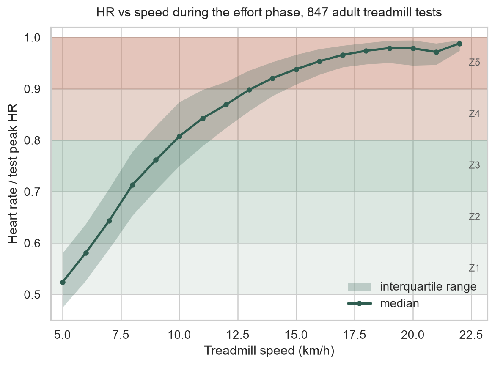
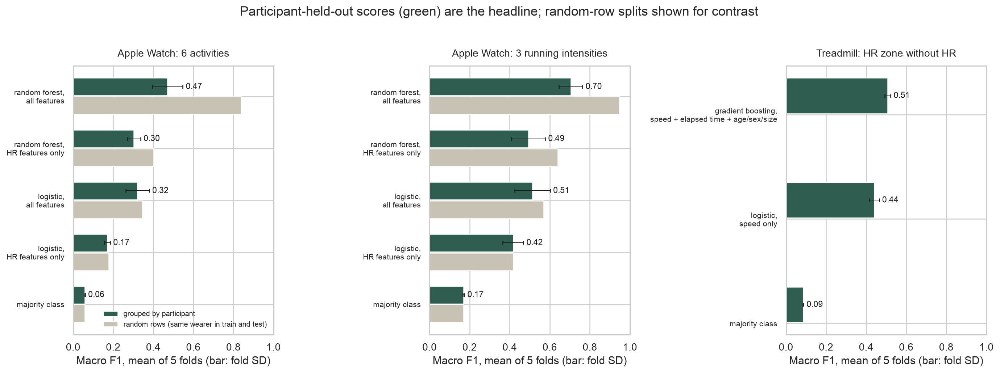
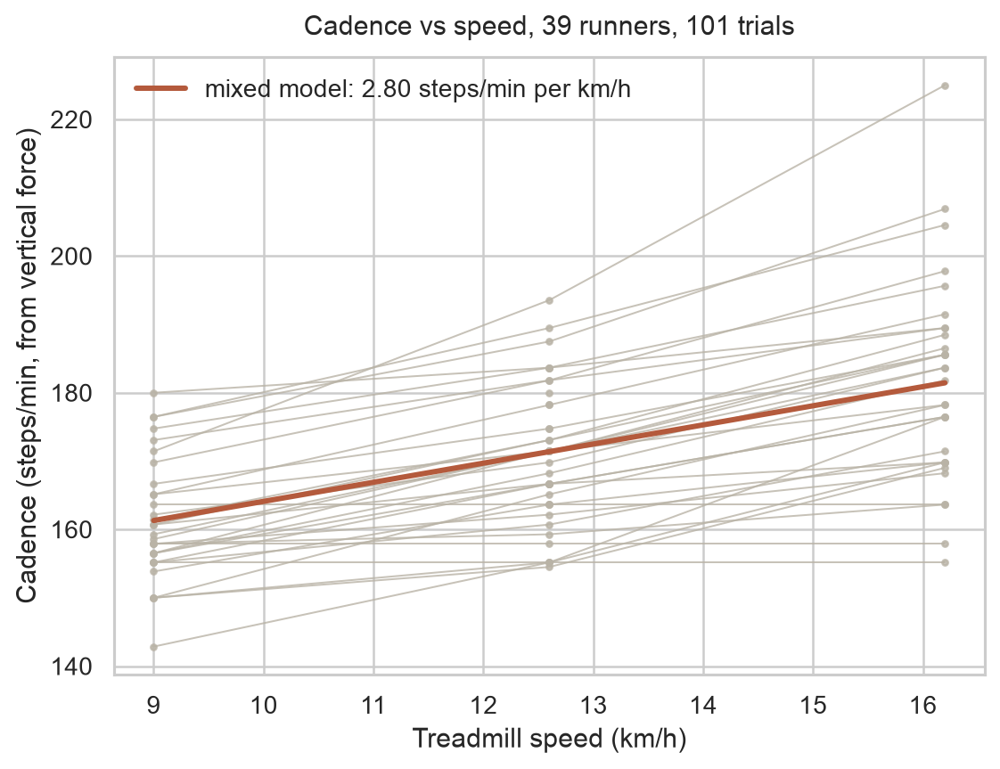

# Wearable running intensity

How well can wrist and treadmill signals tell how hard someone is running, when the model has
never seen that person before? This repo measures it on open data: Apple Watch records from a lab
protocol (49 inferred participants), 847 graded treadmill tests with breath-by-breath heart rate
(737 adults), and force-plate cadence from 39 runners. A short final section maps the resulting HR
zones onto song tempo. A parser for your own Apple Health `export.xml` runs the same summaries on
personal workouts.



## Results

### Intensity prediction, participant held out

Every score is 5-fold cross-validation with each participant's rows kept in a single fold
(`GroupKFold`), reported as mean ± SD over the 5 test folds. From `python -m src.physio`,
written to `results/tables/physio_prediction_scores.csv`.

| Data | Task | Model | Features | Accuracy | Macro F1 |
| --- | --- | --- | --- | --- | --- |
| Apple Watch, 1,788 rows | running at 3 / 5 / 7 METs | majority class | none | 0.343 ± 0.010 | 0.170 ± 0.004 |
| | | logistic | HR only | 0.439 ± 0.057 | 0.417 ± 0.052 |
| | | random forest | HR only | 0.494 ± 0.084 | 0.493 ± 0.084 |
| | | logistic | all | 0.526 ± 0.070 | 0.513 ± 0.089 |
| | | random forest | all | **0.709 ± 0.058** | **0.705 ± 0.059** |
| Apple Watch, 3,656 rows | 6 activities (lying to running at 7 METs) | majority class | none | 0.215 ± 0.004 | 0.059 ± 0.001 |
| | | logistic | HR only | 0.293 ± 0.023 | 0.171 ± 0.014 |
| | | random forest | HR only | 0.314 ± 0.030 | 0.303 ± 0.034 |
| | | logistic | all | 0.343 ± 0.054 | 0.321 ± 0.059 |
| | | random forest | all | **0.489 ± 0.070** | **0.472 ± 0.076** |
| Treadmill, 77,809 breaths | HR zone without HR as input | majority class | none | 0.349 ± 0.009 | 0.086 ± 0.002 |
| | | logistic | speed | 0.558 ± 0.024 | 0.440 ± 0.025 |
| | | gradient boosting | speed, elapsed time, age, sex, size | **0.580 ± 0.011** | **0.508 ± 0.015** |

"All" Apple Watch features are HR, steps, distance, calories, the dataset's entropy and
HR-steps correlation features, and age, sex, height and weight. With the feature set held fixed,
moving from logistic regression to a random forest raises macro F1; with the model held fixed,
adding the non-HR features raises it too.

If the Apple Watch rows are split at random instead of by person, the all-features random forest
scores 0.836 (6 activities) and 0.947 (3 intensities) accuracy. Those numbers overstate accuracy
for a new wearer, because rows from one person share near-constant features and a row split lets
the model recognize the person. They are in the same table file, marked `random rows`.



### HR response to speed, and cadence (measured)

From `results/tables/physio_summary.json`, `physio_zone_entry_speeds.csv` and
`physio_cadence_by_speed.csv`.

| Quantity | Value |
| --- | --- |
| HR rise per km/h of treadmill speed, median over 847 adult tests | 6.3 bpm (IQR 5.3-7.4) |
| Peak HR, median | 187 bpm |
| HR recovery 60 s after peak effort, median (n = 846) | 28 bpm |
| Belt speed when HR first reached 60 / 70 / 80 / 90 % of peak, median | 6.3 / 8.0 / 10.1 / 12.7 km/h |
| Peak speed, median | 16.7 km/h |
| Cadence at 9.0 / 12.6 / 16.2 km/h, mean (31 / 39 / 31 runners) | 161 / 171 / 181 steps/min |
| Cadence vs speed, mixed model | 136.1 + 2.80 x km/h (SE of slope 0.20), runner-to-runner SD 9.7 |



## Method

- **Apple Watch** (`src/physio/fuller.py`): Fuller et al. lab protocol, Apple Watch rows only.
  Participants are inferred from (age, sex, height, weight) because the file has no id column.
  Majority baseline; logistic regression and a 200-tree random forest, each on HR-only and on all
  features.
- **Treadmill** (`src/physio/treadmill.py`): 5-breath rolling median HR, effort phase up to the last
  breath at peak speed, HR-speed slope, zone-entry speed, HRR60. Zones are 50/60/70/80/90 % of the
  measured test peak HR (`src/physio/zones.py`). The zone classifier uses every 5th breath.
- **Cadence** (`src/physio/cadence.py`): foot contacts from vertical ground reaction force with a
  hysteresis threshold, median step interval, linear mixed model with a random intercept per runner.
- **Scoring** (`src/physio/cv.py`): mean and sample SD of fold accuracy and macro F1.

Full details: `docs/methodology.md`.

## Data

| Dataset | Use | License |
| --- | --- | --- |
| Fuller et al., Apple Watch and Fitbit data (Harvard Dataverse, doi:10.7910/DVN/ZS2Z2J) | HR, steps, activity labels | CC0 1.0 |
| Treadmill Maximal Exercise Tests, University of Malaga (PhysioNet, doi:10.13026/7ezk-j442) | HR and speed per breath | PhysioNet Contributor Review Health Data License 1.5.0; files ship with CC BY-NC-SA 4.0 |
| Fukuchi et al., running biomechanics (figshare, doi:10.6084/m9.figshare.4543435) | cadence from force plate | CC BY 4.0 |
| Spotify Web API audio features, saved pull (`data/processed/pop_tracks_raw.csv`) | tempo, energy for the mapping | Spotify Developer Terms |

Raw physiology files are downloaded and checksum-verified, never committed. Citations, and the
datasets considered and left out: `docs/DATA.md`.

## Reproduce

```bash
python3.12 -m venv .venv && source .venv/bin/activate
pip install -r requirements.txt          # pinned versions used for the committed results
python -m src.physio.fetch               # about 66 MB into data/raw/, checked against data/manifest.json
python -m src.physio                     # tables and figures (several minutes, mostly model fitting)
python -m src                            # Spotify appendix tables and figures
pytest -q
```

`python -m src.physio.figures` redraws the physiology figures from the committed tables without
the raw data.

## Your own Apple Watch data

```bash
# iPhone: Health > profile picture > Export All Health Data, unzip, then:
python -m src.physio.apple_health data/raw/apple_health/export.xml --age 30
# or --hr-max 192 if you know your measured maximum
```

Per running workout it writes duration, mean and peak HR, share of HR samples in each zone,
cadence from step counts, mean running speed, and a 1:1 tempo band (cadence plus or minus 3 %)
to `results/tables/my_runs.csv`. Source names, devices and GPS routes are not read. The file
`tests/fixtures/synthetic_export.xml` is synthetic and only used by the tests.

## Tempo-to-zone mapping (not a measured effect)

No open dataset was found that records music tempo together with heart rate or cadence during
runs. This table chains measured relationships from different people: zone to speed (treadmill
tests), speed to cadence (force-plate runners), cadence to tempo (assumes one beat per step, or
per two steps for half-time). It lists which of 821 Spotify pop tracks line up with the typical
step rate in each zone; it does not show that any track changes heart rate or pace.
`results/tables/physio_tempo_zone_map.csv`, figure `results/figures/physio_tempo_zone_map.png`.

| Zone | % HRmax | Speed (km/h) | Mapped cadence and 1:1 tempo | Half-time tempo | Tracks 1:1 | Tracks half-time | Extrapolated |
| --- | --- | --- | --- | --- | --- | --- | --- |
| Z2 | 60-70 | 6.3-8.0 | 154-159 | 77-79 | 13 | 13 | yes |
| Z3 | 70-80 | 8.0-10.1 | 159-164 | 79-82 | 17 | 20 | yes |
| Z4 | 80-90 | 10.1-12.7 | 164-172 | 82-86 | 27 | 18 | no |
| Z5 | 90-100 | 12.7-16.7 | 172-183 | 86-91 | 30 | 35 | yes |

"Extrapolated": part of the speed band lies outside the 9.0-16.2 km/h cadence data. Runner-to-runner
cadence spread (SD 9.7 spm) is wider than any band, so a runner's own cadence from the Health
parser is the better input.

## Repo layout

```
src/physio/        fetch, zones, cv scoring, Apple Watch models, treadmill HR, cadence, mapping,
                   Apple Health parser, figures
src/               Spotify appendix (clean, analyze, plot, mood_playlist, extract_spotify)
data/manifest.json URLs and published checksums for the downloads
data/processed/    saved Spotify sample
results/tables/    every number quoted above (physio_*) and the Spotify appendix tables
results/figures/   every figure shown above (physio_*) and the Spotify appendix figures
docs/              DATA.md, methodology.md, spotify-features.md, data-ethics.md
tests/             unit tests on synthetic inputs, plus a check on the fetched cadence data
```

## Limitations

- The Apple Watch file has no participant id. Grouping by (age, sex, height, weight) gives 49 groups
  while the study reports 46 people, so some people are split across groups. That can only leak
  information across folds, so the grouped scores may be slightly optimistic.
- Fold SDs of up to 0.09 on the Apple Watch tasks reflect about 10 people per fold; differences
  smaller than that between models are not well resolved.
- The MET levels are protocol targets, and the Apple Watch data come from one lab session per
  person. Outdoor running, hills and heat are not covered.
- Zone-entry speeds come from incremental tests where HR lags speed; they are not steady-state zone
  speeds. Zones use percent of peak HR, not lactate or ventilatory thresholds.
- The cadence data cover 9.0-16.2 km/h on a treadmill. Cadence outside that range is extrapolated.
- The tempo mapping links cohorts that never overlapped and assumes one beat per step. Spotify tempo
  estimates can be off by a factor of two.

## Next steps

- Validate the mapping on paired data: runs logged with both a track timeline and HR or cadence.
- Add an outdoor running dataset with per-second HR and speed under a clear license.

## Appendix: Spotify audio features

The 821 tracks used by the mapping also have a separate statistical study (danceability and
valence r = 0.42; energy OLS R² = 0.722; major/minor tests; a valence-band playlist ranking).
Results and methods: `docs/spotify-features.md`.

## License

Code: MIT (`LICENSE`). Data-derived files keep the terms of their sources (`docs/DATA.md`). Files
derived from the PhysioNet treadmill data are shared under CC BY-NC-SA 4.0, not MIT:
`results/tables/physio_zone_entry_speeds.csv`, `results/tables/physio_hr_by_speed.csv`,
`results/tables/physio_tempo_zone_map.csv`, the treadmill entries of `physio_summary.json` and
`physio_prediction_scores.csv`, and the figures built from them (`physio_hr_vs_speed.png`,
`physio_tempo_zone_map.png`, the treadmill panel of `physio_prediction_scores.png`). Raw dataset
files are not redistributed.
