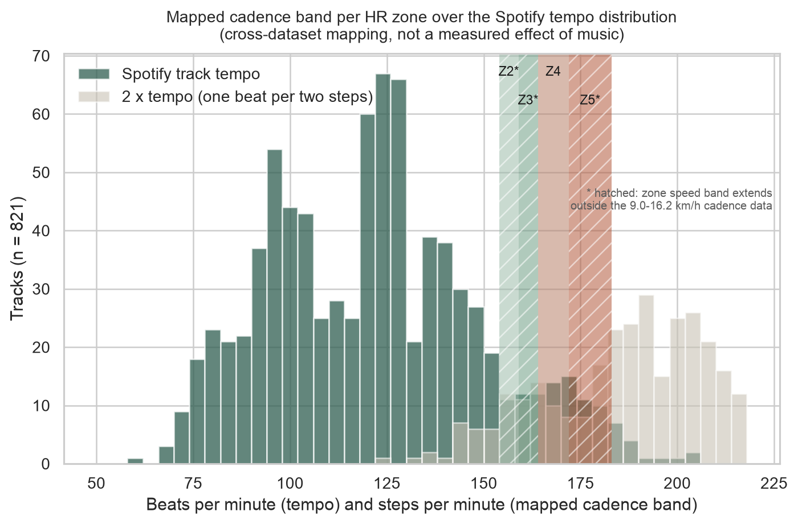

# Spotify tempo and running physiology

How well do wearable signals tell you how hard someone is running, and which songs line up with
the step rate of each heart-rate zone? This repo answers both with open data: Apple Watch records
from a lab protocol, 847 graded treadmill tests with breath-by-breath heart rate, force-plate
cadence from 39 runners, and Spotify audio features for 821 pop tracks. It also parses your own
Apple Health `export.xml` so the same summaries can be run on personal workouts.



## Results

### 1. Predicting activity, intensity and HR zone (measured)

All scores are 5-fold cross-validation with every participant held out of the folds they are
scored on (`GroupKFold`). Produced by `python -m src.physio`, written to
`results/tables/physio_prediction_scores.csv`.

| Data | Task | Model | Accuracy | Macro F1 |
| --- | --- | --- | --- | --- |
| Apple Watch (3,656 rows) | 6 activities | majority class | 0.215 | 0.059 |
| | | logistic, HR features only | 0.292 | 0.173 |
| | | random forest, all features | **0.488** | **0.472** |
| Apple Watch (1,788 rows) | running at 3 / 5 / 7 METs | majority class | 0.343 | 0.170 |
| | | logistic, HR features only | 0.440 | 0.421 |
| | | random forest, all features | **0.710** | **0.707** |
| Treadmill (77,809 breaths, 737 people) | HR zone, without HR as input | majority class | 0.349 | 0.086 |
| | | logistic, speed only | 0.558 | 0.441 |
| | | gradient boosting, speed + elapsed time + age/sex/size | **0.580** | **0.508** |

Splitting the Apple Watch rows at random instead of by person gives 0.836 accuracy (6 activities)
and 0.947 (3 intensities) for the same random forest. That gap is wearer leakage: rows from one
person share near-constant features, so a row split mostly tests whether the model recognizes the
person. Both splits are in the table file and in the figure below.


### 2. HR response to speed and cadence vs speed (measured)

From `results/tables/physio_summary.json`, `physio_zone_entry_speeds.csv` and `physio_cadence_by_speed.csv`.

| Quantity | Value |
| --- | --- |
| HR rise per km/h of treadmill speed, median over 847 adult tests | 6.3 bpm (IQR 5.3-7.4) |
| Peak HR, median | 187 bpm |
| HR recovery 60 s after peak effort, median (n = 846) | 28 bpm |
| Belt speed when HR first reached 60 / 70 / 80 / 90 % of peak, median | 6.3 / 8.0 / 10.1 / 12.7 km/h |
| Peak speed, median | 16.7 km/h |
| Cadence at 9.0 / 12.6 / 16.2 km/h, mean (31 / 39 / 31 runners) | 161 / 171 / 181 steps/min |
| Cadence vs speed, mixed model | 136.1 + 2.80 x km/h (SE of slope 0.20), runner-to-runner SD 9.7 |


### 3. Tempo-to-zone table (a mapping, not a measured effect)

No open dataset was found that records music tempo together with heart rate or cadence during
runs, so this table chains measured relationships from different people: zone to speed (treadmill
tests), speed to cadence (force-plate runners), cadence to tempo (assumes one beat per step, or one
beat per two steps for half-time). It says which tracks line up with the typical step rate in each
zone. It does not say that those tracks change heart rate or pace.
`results/tables/physio_tempo_zone_map.csv`:

| Zone | % HRmax | Speed band (km/h) | Mapped cadence (spm) | Tempo 1:1 (BPM) | Tempo half-time (BPM) | Tracks 1:1 | Tracks half-time | Outside cadence data |
| --- | --- | --- | --- | --- | --- | --- | --- | --- |
| Z2 | 60-70 | 6.3-8.0 | 154-159 | 154-159 | 77-79 | 13 | 13 | yes |
| Z3 | 70-80 | 8.0-10.1 | 159-164 | 159-164 | 79-82 | 17 | 20 | yes |
| Z4 | 80-90 | 10.1-12.7 | 164-172 | 164-172 | 82-86 | 27 | 18 | no |
| Z5 | 90-100 | 12.7-16.7 | 172-183 | 172-183 | 86-91 | 30 | 35 | yes |

Track counts are out of 821. "Outside cadence data" means part of the speed band lies outside the
9.0-16.2 km/h range of the force-plate trials, so cadence there is extrapolated; below about 8 km/h
many people walk, and the running cadence line does not apply. Runner-to-runner cadence spread
(SD 9.7 spm) is wider than any single band, so for one person their own cadence is the better
input (see "Your own Apple Watch data").

### 4. Spotify feature study

The statistical study of the same 821 tracks (danceability and valence r = 0.42, energy OLS
R² = 0.722, major/minor tests) is regenerated by `python -m src`. Details: `docs/methods.md` and
`results/tables/analysis_summary.json`.

## Method

- **Apple Watch** (`src/physio/fuller.py`): Fuller et al. lab protocol, Apple Watch rows only.
  Participants are inferred from (age, sex, height, weight) because the file has no id column.
  Majority baseline, HR-only logistic regression, and a 200-tree random forest on all features.
- **Treadmill** (`src/physio/treadmill.py`): 5-breath rolling median HR, effort phase up to the last
  breath at peak speed, HR-speed slope, zone-entry speed, HRR60. Zones are 50/60/70/80/90 % of the
  measured test peak HR (`src/physio/zones.py`).
- **Cadence** (`src/physio/cadence.py`): foot contacts from vertical ground reaction force with a
  hysteresis threshold, median step interval, linear mixed model with a random intercept per runner.
- **Mapping** (`src/physio/mapping.py`): median zone-entry speeds to cadence via the fixed-effect
  line, then tempo matches at 1:1 and 2:1.

Full details, including what is measured and what is mapped: `docs/methodology.md`.

## Data

| Dataset | Use | License |
| --- | --- | --- |
| Fuller et al., Apple Watch and Fitbit data (Harvard Dataverse, doi:10.7910/DVN/ZS2Z2J) | HR, steps, activity labels | CC0 1.0 |
| Treadmill Maximal Exercise Tests, University of Malaga (PhysioNet, doi:10.13026/7ezk-j442) | HR and speed per breath | PhysioNet Contributor Review Health Data License 1.5.0 |
| Fukuchi et al., running biomechanics (figshare, doi:10.6084/m9.figshare.4543435) | cadence from force plate | CC BY 4.0 |
| Spotify Web API audio features, saved pull (`data/processed/pop_tracks_raw.csv`) | tempo, energy | Spotify Developer Terms |

Raw physiology files are downloaded and checksum-verified, never committed. Citations, and the
datasets that were considered and left out: `docs/DATA.md`.

## Reproduce

```bash
python -m venv .venv && source .venv/bin/activate
pip install -r requirements.txt
python -m src.physio.fetch     # about 66 MB into data/raw/, every file checked against data/manifest.json
python -m src.physio           # physiology tables and figures (several minutes, mostly model fitting)
python -m src                  # Spotify feature study tables and figures
pytest -q
```

`python -m src.physio.figures` redraws the physiology figures from the committed tables without the
raw data. A new Spotify API pull will not reproduce the saved track sample; use the committed CSV.

## Your own Apple Watch data

```bash
# iPhone: Health > profile picture > Export All Health Data, unzip, then:
python -m src.physio.apple_health data/raw/apple_health/export.xml --age 30
# or --hr-max 192 if you know your measured maximum
```

Per running workout it writes duration, mean and peak HR, share of HR samples in each zone, cadence
from step counts, mean running speed, and a 1:1 tempo band (cadence plus or minus 3 %) to
`results/tables/my_runs.csv`. Source names, devices and GPS routes are not read. The file
`tests/fixtures/synthetic_export.xml` is synthetic and only used by the tests.

## Repo layout

```
src/physio/        fetch, zones, Apple Watch models, treadmill HR, cadence, mapping, Health parser, figures
src/               Spotify feature study (clean, analyze, plot), mood_playlist.py, tune.py
data/manifest.json URLs and published checksums for the downloads
data/processed/    saved Spotify sample
results/tables/    every number quoted above
results/figures/   every figure shown above
docs/              DATA.md, methodology.md, methods.md (Spotify study), data-ethics.md, archive/
tests/             unit tests on synthetic inputs, plus a check on the fetched cadence data
```

`src/mood_playlist.py` ranks tracks inside a valence band; `src/tune.py` slows a track and mixes in
rain noise with ffmpeg. Neither uses physiology data. Earlier pitch and report PDFs are in
`docs/archive/`.

## Limitations

- The Apple Watch file has no participant id. Grouping by (age, sex, height, weight) gives 49 groups
  while the study reports 46 people, so some people are split across groups. That can only leak
  information across folds, so the grouped scores may be slightly optimistic.
- The MET levels are protocol targets, and the Apple Watch data come from one lab session per
  person. Outdoor running, hills and heat are not covered.
- Zone-entry speeds come from incremental tests where HR lags speed; they are not steady-state zone
  speeds. Zones use percent of peak HR, not lactate or ventilatory thresholds.
- The cadence data cover 9.0-16.2 km/h on a treadmill. Cadence outside that range is extrapolated.
- The tempo table links cohorts that never overlapped and assumes one beat per step. It is not
  evidence that tempo-matched music changes heart rate, cadence or effort. Spotify tempo estimates
  can be off by a factor of two.
- The Spotify sample covers pop releases from 2011-2022 only.

## Next steps

- Validate the mapping on paired data: runs logged with both a track timeline and HR or cadence
  (for example a personal Health export plus Spotify listening history).
- Add an outdoor running dataset with per-second HR and speed under a clear license.

## License

Code: MIT (`LICENSE`). Datasets keep their own licenses (`docs/DATA.md`); raw files are not
redistributed here.

## Acknowledgements

The Spotify feature study began as a group notebook analysis, and the mood-playlist helper comes
from joint work with Kavin Jindel and Adit Agarwal (report in `docs/archive/`).
